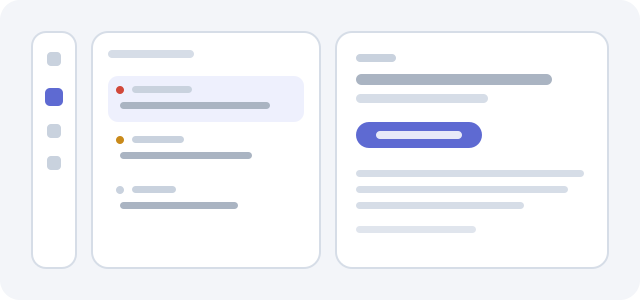

# Linear desk

Read the Linear issues assigned to you inside DeepSeek Harness, without switching to a browser tab.

## What it does

- Adds a **Linear desk** entry to the sidebar (checklist icon, order 7).
- The main area is a three-part panel: filters on top, issue list on the left, detail (description plus the latest 15 comments) on the right.
- The default view is **assigned to me + open**, sorted by status, then priority, then last update.
- The list groups issues by status, the way Linear does, with collapsible headers and a per-group count.
- Detail renders a Linear-style property grid, plus parent issue, sub-issues with progress, relations, attachments, and the comment thread.
- **Start work in a session** builds a draft from the issue key, title, status, URL, and description, then opens a new session with that draft pre-filled. It does **not** send the message; you finish the wording yourself.
- **Copy as Markdown** produces the same digest on the clipboard.

## Interaction details

Keyboard: `j` / `k` or the arrow keys move through the list, `/` focuses the search field, `r` or `Cmd+R` reloads the list without reloading the page (filters and selection survive), `Esc` leaves the field.

Accessibility: the panel follows the system appearance, honours Reduce Motion and Increase Contrast, keeps a visible focus ring for full keyboard access, labels every select and the search field for screen readers, marks the selected row with `aria-current`, uses `aria-pressed` for the scope switch instead of tab roles, and announces toasts through a polite live region. Body text stays at 12 px or larger and every colour pair meets WCAG AA in both appearances.

Layout: the search field sits at the trailing edge of the filter bar; below 760 px the list stacks above the detail and the property grid collapses to one column.

## What it does not do

- No writes: no status change, comment, reassignment, or issue creation. This version is read-only.
- No persistence: every cache is in memory and dies with the process.
- No session footprint: panel reads go through `ctx.tools.execute` without a session, so they never appear in a conversation trajectory.

## Where the data comes from

The plugin reuses the existing `mcp-linear` connection (`mcp__linear__*` tools) instead of opening its own Linear client, so OAuth and token refresh stay in `mcp-linear`.

The panel page fetches from `/linear-desk/api/*`, and the host half translates each request into MCP tool calls:

| Route | Backed by MCP tool |
| --- | --- |
| `GET /linear-desk/api/health` | None — reads `tools` / `mcpManager` registration state |
| `GET /linear-desk/api/locales` | None — returns the shipped language list |
| `GET /linear-desk/api/bootstrap` | `whoami`, `list_teams` |
| `GET /linear-desk/api/issues?view=&team=&state=&priority=&query=` | `list_issues` |
| `GET /linear-desk/api/issue?id=` | `get_issue`, `list_comments`, plus a parent lookup and `list_issues({ parentId })` for sub-issues |

The **Open** filter (`state=open`) is synthesised by the panel. Linear's `state` argument accepts a single state and cannot express "not Done", so the host does not send it: it fetches a larger page and filters out completed and canceled issues locally by `statusType`.

Parent issues in another workspace (a `DAW-306` parent, for example) cannot be read with the current credentials. The panel degrades to an ID link instead of failing the whole detail view.

## Connection and failure behaviour

The desk uses the first usable Linear connection it finds:

1. Your own `mcp-linear` (`serverName: linear`, tools named `mcp__linear__*`). When it is connected the desk never opens a second connection.
2. A `linear_desk` server the plugin registers itself, pointing at Linear's official read-only endpoint `https://mcp.linear.app/mcp/readonly`. It is registered only when no usable Linear tool exists and the name is free. Registration is deferred by five seconds so a cold start does not mistake a connecting `mcp-linear` for a missing one.

The second path authenticates with `${credential:LINEAR_API_KEY}`. When that key is not stored yet, the panel header renders an input for it; the value is posted to the host, written through the credentials provider, and injected into the transport headers. The panel never stores or echoes the key. The server reconnects on its own when the credential changes, because the MCP client listens for `credentials/reference-updated`.

If no connection can be established the panel header turns red and explains what is missing rather than showing an empty page.

## Languages

English and Chinese ship today. Translations live in `assets/i18n/*.json` as flat key/value files; the panel asks the host which languages exist and falls back to English, then to the raw key. Adding a language means adding a JSON file and one line in `LOCALES` / `LABELS`.

## Settings

This version has no configurable options and `cordis.patch.yml` passes no config. Team, state, and priority filters apply immediately in the panel and are not persisted.
